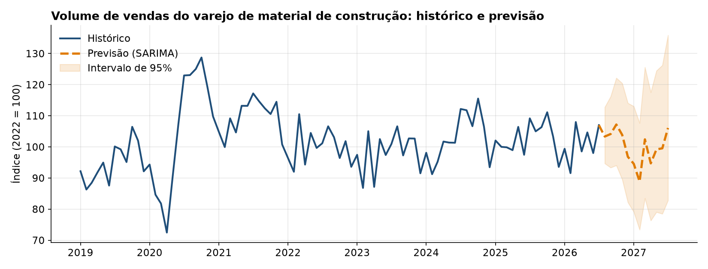
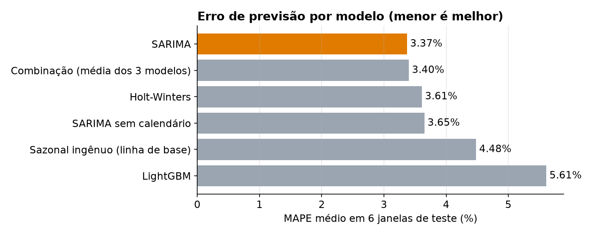
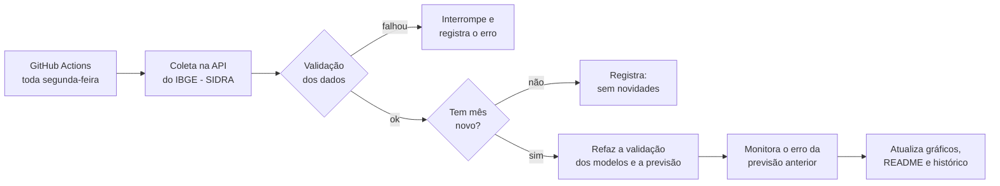

# Previsão de Vendas do Varejo de Material de Construção

**Pipeline automatizado:** toda semana, o GitHub Actions verifica se o IBGE publicou um mês novo e, se publicou, baixa os dados, valida, refaz a previsão, mede o erro da previsão anterior e atualiza este README.

> **Resultado:** previsão dos próximos 12 meses com erro médio (MAPE) de **3,37%**, **25% menor** que a linha de base, usando SARIMA com variáveis de calendário, validado em 6 janelas de teste sem uso de dados do futuro.

[](https://github.com/gabrieldeoliver1/previsao-vendas-material-construcao/actions/workflows/testes.yml)
[](https://github.com/gabrieldeoliver1/previsao-vendas-material-construcao/actions/workflows/atualizar.yml)




## 📅 Situação atual

<!-- INICIO_ATUALIZACAO -->
- **Última verificação:** 11/10/2026
- **Último mês publicado pelo IBGE:** jul/2026 (índice 107,0)
- **Previsão para ago/2026:** 103,3 (intervalo de 95%: 94,7 a 112,8)
- **Erro médio do modelo na validação (MAPE):** 3,37%
<!-- FIM_ATUALIZACAO -->

## Problema de negócio

Para um home center, saber quanto o mercado vai vender nos próximos meses orienta compras, estoque, escala de equipes e metas. Este projeto prevê o **volume de vendas do varejo de material de construção no Brasil** para os próximos 12 meses, a partir de dados públicos do IBGE, e compara modelos de previsão com uma validação que simula o uso real.

## Dados

- **Fonte:** IBGE, Pesquisa Mensal de Comércio, [tabela 8883](https://sidra.ibge.gov.br/tabela/8883)
- **Variável:** índice de volume de vendas de material de construção (2022 = 100), sem ajuste sazonal
- **Período:** janeiro de 2003 a julho de 2026, 283 meses, sem lacunas

O índice de volume mede a quantidade vendida, sem o efeito da inflação. A série sem ajuste sazonal foi escolhida porque a sazonalidade faz parte do que precisa ser previsto.

## Principais descobertas

- **Sazonalidade forte:** de julho a novembro as vendas ficam de 3% a 7% acima da tendência; fevereiro é o mês mais fraco, cerca de 11% abaixo.
- **O calendário importa:** cada dia útil a mais no mês soma cerca de **3,2%** ao volume de vendas, e cada sábado a mais, cerca de **1,5%**. Incluir essas variáveis reduziu o erro do SARIMA de 3,66% para 3,37%.
- **Choques dominam a história:** a recessão de 2015-2016 e o boom de reformas na pandemia, com o pico histórico em outubro de 2020, são os maiores desvios da série.
- **O modelo mais sofisticado não venceu:** o LightGBM ficou pior que a linha de base. Com 283 observações mensais, os modelos estatísticos capturam melhor a estrutura da série.

## Abordagem

1. **Preparação:** conversão da tabela do IBGE, que vem em formato largo, para uma série mensal.
2. **Análise exploratória:** tendência, choques, decomposição STL, perfil sazonal e efeito do calendário.
3. **Modelos:** sazonal ingênuo (linha de base), Holt-Winters, SARIMA com e sem variáveis de calendário, LightGBM e combinação de modelos.
4. **Validação por origem móvel:** em 6 pontos de corte semestrais, de jan/2023 a jul/2025, cada modelo é treinado só com o passado e prevê os 12 meses seguintes.
5. **Painel interativo** em Streamlit com previsão, intervalo de confiança, sazonalidade e comparação de modelos.

## Resultados



| Modelo | MAPE | RMSE | Ganho sobre a linha de base |
|---|---|---|---|
| **SARIMA com calendário** | **3,37%** | **4,30** | **25%** |
| Combinação (média de 3 modelos) | 3,40% | 4,48 | 24% |
| Holt-Winters | 3,61% | 4,48 | 20% |
| SARIMA sem calendário | 3,66% | 4,57 | 18% |
| Sazonal ingênuo (linha de base) | 4,48% | 5,66 | – |
| LightGBM | 5,61% | 6,93 | –25% |

O modelo final é um **SARIMA(1,1,0)x(1,1,1,12)** sobre o logaritmo da série, com dias úteis e sábados de cada mês como variáveis externas. A previsão para os próximos 12 meses aponta para uma **leve retração, de cerca de 2%** em relação aos últimos 12 meses, mantendo a sazonalidade.

## Pipeline de atualização automática



| Etapa | O que faz | Arquivo |
|---|---|---|
| **Coleta** | Consulta os metadados da tabela 8883 no IBGE, encontra a variável e as categorias **pelo nome** (sem depender de códigos fixos) e baixa a série completa | `pipeline/coletar.py` |
| **Validação** | Interrompe a atualização se houver meses faltantes, valores implausíveis ou mudança de mais de 5% no histórico | `pipeline/atualizar.py` |
| **Previsão** | Refaz a validação por origem móvel dos 6 modelos e a previsão dos próximos 12 meses | `src/avaliacao.py` |
| **Monitoramento** | Guarda cada previsão em `historico_previsoes.csv` e, quando o valor real é publicado, calcula o erro e verifica se ficou dentro do intervalo de 95% | `data/resultados/monitoramento.csv` |
| **Publicação** | Atualiza os gráficos e a seção "Situação atual" deste README e registra o resultado em `status_pipeline.json` | `src/graficos.py` |

Cada execução fica registrada na aba **Actions** do repositório, e a atualização também pode ser disparada manualmente.

## Painel interativo

O painel mostra o histórico e a previsão com intervalo de 95%, o perfil sazonal por ano e a comparação entre os modelos em cada janela de teste.

```bash
pip install -r requirements.txt
streamlit run app.py
```

## Como reproduzir

```bash
git clone https://github.com/gabrieldeoliver1/previsao-vendas-material-construcao.git
cd previsao-vendas-material-construcao
pip install -r requirements.txt

python src/preparar_dados.py   # converte a tabela do IBGE na série mensal
python src/avaliacao.py        # validação dos modelos e previsão final (alguns minutos)
python -m pipeline.atualizar   # pipeline completo: coleta no IBGE, validação e previsão
pytest -q tests                # testes automatizados
```

A análise completa, com gráficos e comentários, está em [`notebooks/analise_e_modelagem.ipynb`](notebooks/analise_e_modelagem.ipynb).

## Estrutura do projeto

```
├── app.py                         # Painel interativo em Streamlit
├── data/
│   ├── raw/                       # Tabela original do IBGE
│   ├── processed/                 # Série mensal limpa
│   └── resultados/                # Validação, previsão e parâmetros do modelo final
├── docs/                          # Imagens do README
├── notebooks/
│   └── analise_e_modelagem.ipynb  # Análise exploratória, modelagem e conclusões
├── src/
│   ├── preparar_dados.py          # Conversão dos dados do IBGE
│   ├── modelos.py                 # Features de calendário e modelos de previsão
│   ├── avaliacao.py               # Validação por origem móvel e previsão final
│   └── graficos.py                # Imagens do README
├── pipeline/
│   ├── coletar.py                 # Coleta na API do IBGE
│   └── atualizar.py               # Validação, previsão, monitoramento e publicação
├── tests/                         # Testes automatizados (pytest)
└── .github/workflows/             # Testes e atualização automática
```

## Limitações e próximos passos

- O índice é nacional; o comportamento de um estado ou de uma loja específica pode ser diferente.
- Choques como a pandemia não são previsíveis pelo histórico. Uma evolução é incluir variáveis econômicas, como juros, crédito imobiliário e emprego.
- Feriados nacionais, como o Carnaval, ainda não entram no cálculo de dias úteis.
- Publicar o painel interativo online, no Streamlit Community Cloud.

## 🔗 Contato

[](https://www.linkedin.com/in/gabrieldeoliver1/)

Email: gabrieldeoliver1@gmail.com
